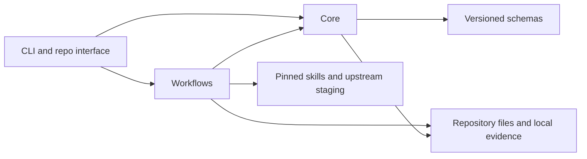

# Architecture

ARRS has a local CLI over a small repository-contract core. It uses Node.js 22+, strict TypeScript, versioned JSON schemas and filesystem evidence. No model API or orchestration service participates in ordinary operation.

## Modules and responsibility

`src/cli.ts` parses the explicit command surface and reports errors. `src/core/` owns configuration, schema validation, safe repository paths, command execution, architecture/security checks, doctor and cumulative audit. `src/workflows/` owns initialization, proof, risk/work readiness, metrics, Gardener and skills operations. Schemas and packaged bootstrap assets remain data outside the runtime modules.

The repository's architecture policy declares each module's root path, allowed dependency identifiers and public paths. The scanner inspects JavaScript/TypeScript import/export syntax and `require` calls in declared source. Ownership determines which dependency and public interface rules apply. A mutation check tests whether the same scanner rejects a deliberately forbidden import; declaring a policy alone is insufficient evidence of enforcement.

Declared source is scanned regardless of directory names such as `build`, `vendor` or `dist`. Exclude generated architecture modules explicitly with `generated: true`; the most-specific normalized module path determines ownership. A generated child is excluded when traversing its handwritten parent, while a separately declared handwritten descendant is checked independently. The mutation guard uses the same source discovery and selects handwritten source and target candidates. Broad diagnostic discovery retains its default directory filters; those filters do not define declared-source coverage.

## Boundary adapter limits

The bundled adapter handles literal relative imports, re-exports and direct CommonJS `require` calls. Unowned local source, unresolved relative imports, computed imports and private/deep cross-module imports fail closed. Alternative loaders such as `createRequire`, `module.require`, recognizable `require` aliases and resolver APIs are conservatively rejected. Ordinary bare dependency packages are allowed; they are not resolved into repository modules. Detected TypeScript path aliases/base URL resolution are unsupported, so repositories using those mechanisms need explicit remediation rather than an unearned enforcement claim.

The checker cannot infer runtime dependency injection or generated source semantics. Mark generated scope deliberately and inspect exclusion effects. A versioned opt-in [provisional Python adapter and conformance](adapter-conformance.md) is available for bounded controls testing; actual real-pilot selection is outstanding. Unsupported languages/loading mechanisms still require a stack-specific mechanical gate; native tests alone do not qualify architecture.

## Extension model

v0.1 exposes configuration and schemas as the primary extension points: project commands, verification targets, knowledge paths, module boundaries, risk classes, sensitive paths, work labels and skills location. It has no dynamic plugin registration ABI. A new runtime uses argument vectors; a structural adapter requires a versioned coverage contract and positive/negative conformance. Optional policy `adapter` selects a known identity/contract; absent selection retains JS/TS behavior. Unknown identities/versions fail. This fixed internal seam is not a plugin registration ABI.

Keep a behaviour in one owning module. Avoid letting workflows import another workflow's private implementation. Use shared core interfaces only when the relationship is real and testable. Changes to serialized contracts require explicit schema evolution; unknown versions fail rather than being silently interpreted as v0.1.

## Trust boundaries

Schemas check data structure. Safe-path checks reject repository path escape, including relevant symlink escape. Configured commands remain trusted code run with the user's permissions. Logs and hashes support local evidence integrity; they are not authenticated execution attestation. The [security limitations](../security.md) and [proof limitations](../proof-contract.md) describe those boundaries.

The ADRs explain [JSON/argv](../adr/0001-versioned-json-and-argv.md), [explicit audit execution](../adr/0002-explicit-audit-execution.md) and [pinned upstream separation](../adr/0003-pinned-upstream-and-derived-skills.md).
